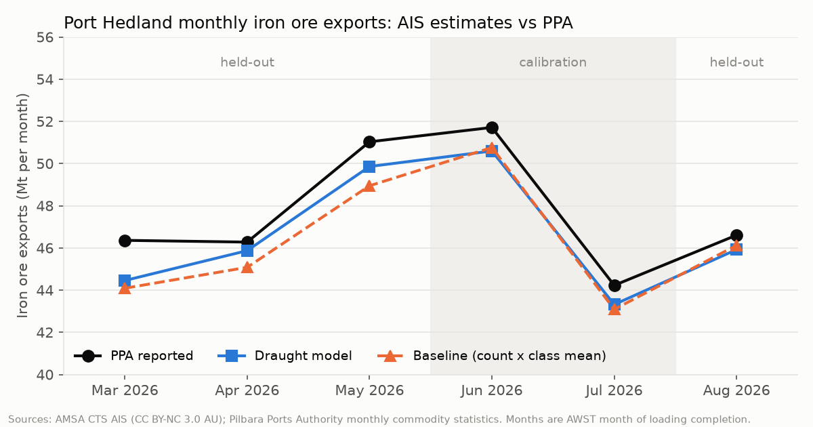
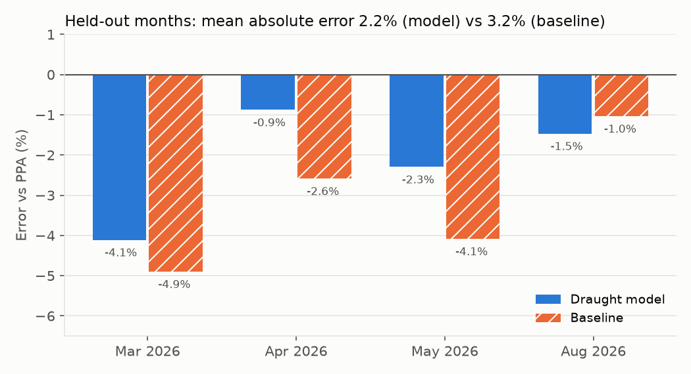
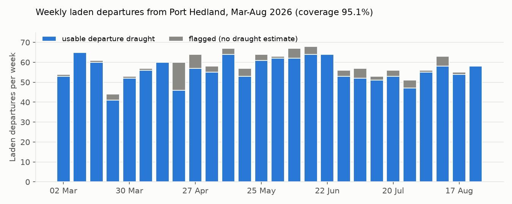

# Estimating Port Hedland iron ore exports from free AIS data

## Summary

Port Hedland, in Western Australia's Pilbara, exported 44-52 Mt of iron ore a month between March and August 2026
according to its operator, Pilbara Ports Authority (PPA), which publishes monthly export statistics. This project asks whether those monthly iron ore figures can be reproduced
independently from free, public ship-tracking data: the Australian Maritime Safety Authority's (AMSA) monthly AIS
extracts, using each ship's dimensions and the draught it reports when it leaves port.

On four held-out months (March, April, May and August 2026), the draught model's monthly estimates are within
**2.2% of PPA on average** (worst month 4.1%), with a usable departure draught for **95% of laden departures**. A
simpler baseline that ignores draught (laden departures x average cargo per size class) is within 3.2%. Both pass the
pre-set kill criteria. The model beats the baseline in 3 of 4 months by about one percentage point, which is too thin,
over four months, to call draught clearly better than counting ships.



## Data

| Source | What it gives | Used for |
|---|---|---|
| AMSA Craft Tracking System, monthly "sub-areas" extract, North West area, Mar-Aug 2026 | 5.05 M AIS position reports, about one per 15 min per ship: id, position, speed, course, type, length, beam, draught, time | Everything on the AIS side |
| SLIP LGATE-243 Port Authorities boundary | Port Hedland port limit polygon | Port calls |
| OpenStreetMap `seamark:type=berth` | 19 berth polygons | Where a ship stopped |
| PPA Port of Port Hedland handbook (A941965) | Use of each berth (§6.13-6.23) | Which berths load iron ore |
| PPA monthly "cargo, GRT and DWT statistics by commodity type" | Per-call cargo lines with dates and tonnes | Calibration (Jun, Jul) and validation (monthly totals) |

Things the AIS data does not have: no IMO number, MMSI, name or call sign, so ships cannot be joined to registries
or to PPA records by identity. The AIS type field has no "bulk carrier" value. The older files (Mar-May 2026) use a
different schema from the newer ones, including a true 12-hour clock; the loader handles both explicitly and the clock
was checked to be continuous across the format change.

## Method

**1. Port calls (EPSG:7850).** All distance and containment work is in GDA2020 / MGA zone 50. A call runs from the
first ping inside the port limit (SLIP polygon + 500 m, which closes a gap over a berth area) to the first ping
outside; inside runs less than 2 h apart are one call.

**2. Laden departures, without using draught.** A call is a laden departure if the ship is a cargo-type vessel of
at least 150 m, spent at least 6 h stationary (< 0.5 kn) at one of the 16 iron ore loading berths, its last
significant stop was at a loading berth, it left within 6 h of that stop ending, and it did not re-enter within 4 h.
Berth roles come from the handbook: BHP Nelson Point and Finucane Island, Fortescue Anderson Point and Roy Hill
SP1/SP2 load iron ore only; Utah Point (PH4) loads iron ore, manganese and spodumene. Keeping draught out of this
definition matters: otherwise the coverage figure would be circular.

**3. Departure draught and flags.** Cargo uses the draught reported at the last ping inside the port limit, never
the change from arrival draught (ballast is pumped out while loading, so the change understates cargo). Calls are
flagged and given no draught estimate if the draught is missing (`no_draught`), unchanged from arrival
(`static_draught`), below a per-class threshold (`light_departure`), the AIS code for "25.5 m or more"
(`implausible`), or there is a gap of over 60 min at the port-limit crossing (`ais_gap`). Flagged calls are counted
and filled with the class-average cargo in monthly totals; they are never set to zero.

**4. Model.** `cargo = a x L x B x T_out x 1.025 - b`, with `a` and `b` fitted per size class (small < 260 m,
Capesize 260-310 m, VLOC 310 m+) to PPA tonnes.

**5. Calibration without identities.** Because AIS has no ship names, AIS calls cannot be paired with PPA calls one
to one. Instead, calls are grouped by date: all AIS laden departures on a given day and all PPA calls on the same day
form a group, and a group is used only if both sides have the same number of calls. The fit is on group totals.
Calibration months were June and July 2026; the rule, the months and the error metric were written down and
committed before any PPA tonnes were joined to AIS (`docs/preregistration.md`).

## Results

| Held-out month | Laden departures | Coverage | Model error | Baseline error |
|---|---|---|---|---|
| Mar 2026 | 245 | 97.6% | -4.1% | -4.9% |
| Apr 2026 | 251 | 92.4% | -0.9% | -2.6% |
| May 2026 | 272 | 93.8% | -2.3% | -4.1% |
| Aug 2026 | 255 | 96.9% | -1.5% | -1.0% |
| **Mean absolute** | | **95.2%** | **2.2%** | **3.2%** |



Kill criteria, set before the project started: stop if coverage < 60%, monthly error > 10%, or the model does not
beat the baseline. None was triggered.



## What did not go to plan, and what it means

**The pre-registered matching rule matched too few calls.** The original keys combined PPA's arrival, cargo-complete
and departure dates. Only 14% of calibration departures landed in balanced groups. Comparing daily counts showed why:
PPA's "arrival" is not the ship's arrival at the port limit (it most likely means arrival at the berth, after days at
anchor), and PPA's departure date lines up with the AIS port-limit exit only after a +4 h shift, consistent with PPA
recording berth departure in local time a few hours before the ship clears the port limit. The rule was amended to use
the departure date alone with a fixed set of shifts, chosen by match rate only. **This amendment was made after the
calibration fit's in-sample residuals had been seen**, which the pre-registration records. The original rule was still
run on the held-out months: 4.2% (model) vs 4.5% (baseline), which also passes.

**Per-ship cargo estimates are not reliable even though monthly totals are.** Six parameters fitted to 21 group totals
whose groups mix size classes are poorly identified. The fitted VLOC slope (1.55) is physically implausible. The model
gives sensible totals because errors cancel across ~250 ships a month, but the per-call `cargo_t` column should not be
read as an accurate figure for an individual ship.

**Everything runs about 2% low**, in calibration months too (June -2.2%, July -2.1%). Candidates, none yet tested:
laden departures missed by the definition (calls with no clear loading stop), calls cut off at the start of the data
(March is missing loadings that began in February), and the Utah Point share of iron ore.

## Limitations

- Only six months of one port; four held-out months is a small test.
- PPA dates carry no time of day and no stated time zone; the month boundary is inferred.
- Berth polygons are OpenStreetMap boxes, about 300 m long; their accuracy is unverified.
- The port limit is the SLIP LGATE-243 polygon plus 500 m; its equivalence to the handbook port limit is unverified.
- Out of scope: live AIS, paid feeds, Cape Lambert, and offshore transhipment ports.

## Reproducing

```
python scripts/s2/fetch_amsa.py 6410:2026-03 6450:2026-04 6490:2026-05 6530:2026-06 6570:2026-07 6590:2026-08
PYTHONPATH=src python -m pilbara_oreflow.run --months 2026-03 2026-04 2026-05 2026-06 2026-07 2026-08
PYTHONPATH=src python scripts/s2/calibrate.py
PYTHONPATH=src python scripts/s3/evaluate.py
PYTHONPATH=src python scripts/s4/figures.py
python -m pytest tests          # synthetic data only
```

PPA statistics are read in a browser (the site blocks scripted clients); see `scripts/s3/ppa_monthly_totals.js`.

## Attribution

- Vessel tracking data: Australian Maritime Safety Authority, Craft Tracking System, CC BY-NC 3.0 AU.
- Port statistics and port handbook: Pilbara Ports Authority.
- Port limit: Landgate SLIP LGATE-243.
- Berth polygons: (c) OpenStreetMap contributors, ODbL.
